<div align="center">

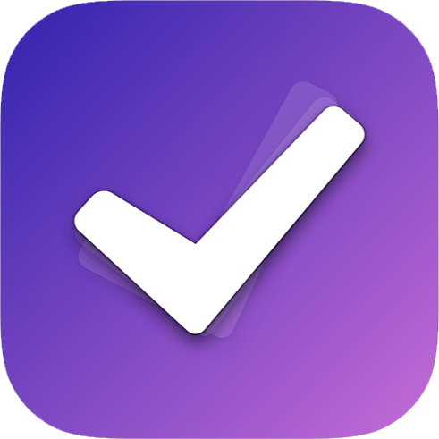

# ToDoList

**An Android task planner with the Eisenhower Matrix, statistics and gamification.**

[](https://github.com/MNJMARIA/ToDoList/actions/workflows/ci.yml)
[](../../releases/latest)
[](https://developer.android.com/)
[](https://www.java.com/)
[](https://firebase.google.com/)
[](LICENSE)

<br>

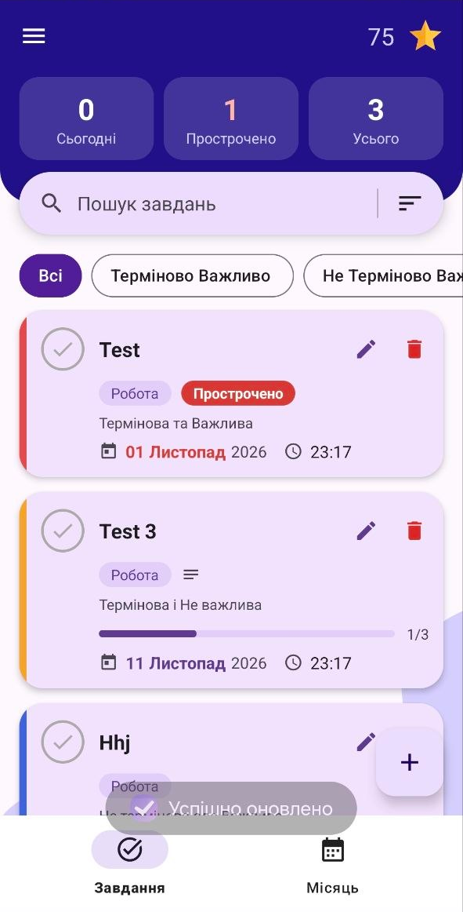
&nbsp;
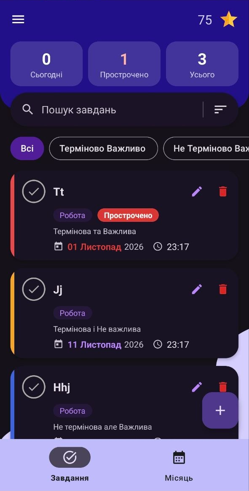
&nbsp;
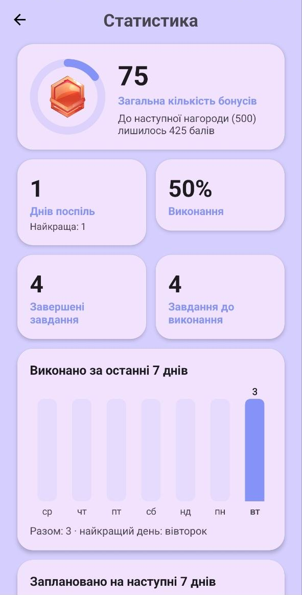

<sub>The screenshots show the Ukrainian interface (version 1.5.0). The app is also available in English, French and German.</sub>

</div>

## Contents

- [Overview](#overview)
- [Features](#features)
- [Download and updates](#download-and-updates)
- [Build from source](#build-from-source)
- [Quality: tests and automatic reports](#quality-tests-and-automatic-reports)
- [Technologies](#technologies)
- [Architecture](#architecture)
- [Documentation](#documentation)
- [Acknowledgments](#acknowledgments)
- [License](#license)

## Overview

ToDoList helps you organise daily tasks, rank them with the **Eisenhower Matrix** (urgent / important), see how you are doing in charts, and stay motivated with points and achievements.

It started as a qualification (diploma) project for the "Software Engineering" program at the **College of Engineering, Management and Land Management, National Aviation University** (Kyiv, Ukraine, 2024) and is now maintained as a living project: a revived codebase with signed releases, automatic tests and in-app updates.

## Features

### Tasks

<table>
  <tr>
    <td width="50%" valign="top">
      <ul>
        <li>Create, edit and delete tasks; mark them as done</li>
        <li><b>Swipe</b> a card right to finish it, left to delete it. A snackbar with <b>Undo</b> brings it back, together with the points and counters</li>
        <li><b>Eisenhower Matrix</b>: four priorities (urgent and important, urgent but not important, not urgent but important, neither), shown as a coloured strip on the card; filter chips and search above the list</li>
        <li>Categories: Work, Personal, Study, Health, Family, Hobby</li>
        <li>Deadline with date and time, an "Overdue" badge and a red date for late tasks</li>
        <li><b>Subtasks</b> with a progress bar on the card (for example <code>1/3</code>) and free-text <b>notes</b></li>
        <li><b>Repeating tasks</b>: daily, weekly or monthly. Finishing one creates the next turn from the original series (31 Jan → 28 Feb → 31 Mar), skipping days that have already passed</li>
        <li>Works <b>offline</b>: tasks created without a connection are kept on the phone and synced later</li>
      </ul>
    </td>
    <td width="25%" align="center" valign="top">
      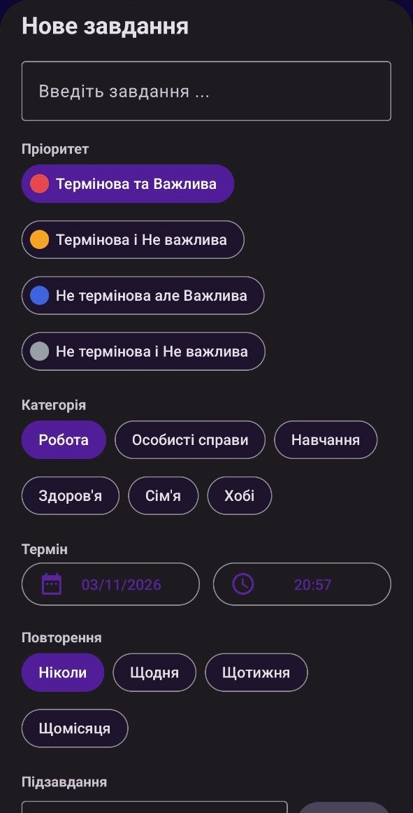<br>
      <sub>New task sheet</sub>
    </td>
    <td width="25%" align="center" valign="top">
      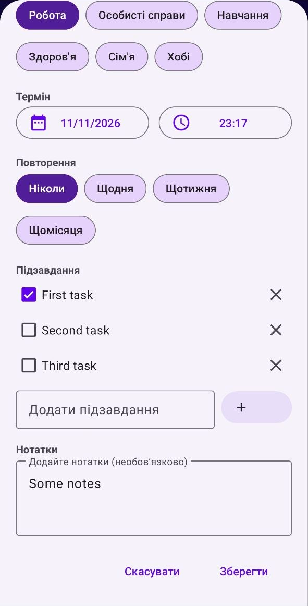<br>
      <sub>Subtasks and notes</sub>
    </td>
  </tr>
</table>

### Day and Month views

<table>
  <tr>
    <td width="50%" valign="top">
      <ul>
        <li><b>Tasks</b> – the whole list with a summary (today / overdue / total), search, sorting and priority filters</li>
        <li><b>Month</b> – a calendar; tap a day to see its tasks. The <b>+</b> button creates a task for the selected day</li>
      </ul>
    </td>
    <td width="25%" align="center" valign="top">
      <br>
      <sub>Tasks</sub>
    </td>
    <td width="25%" align="center" valign="top">
      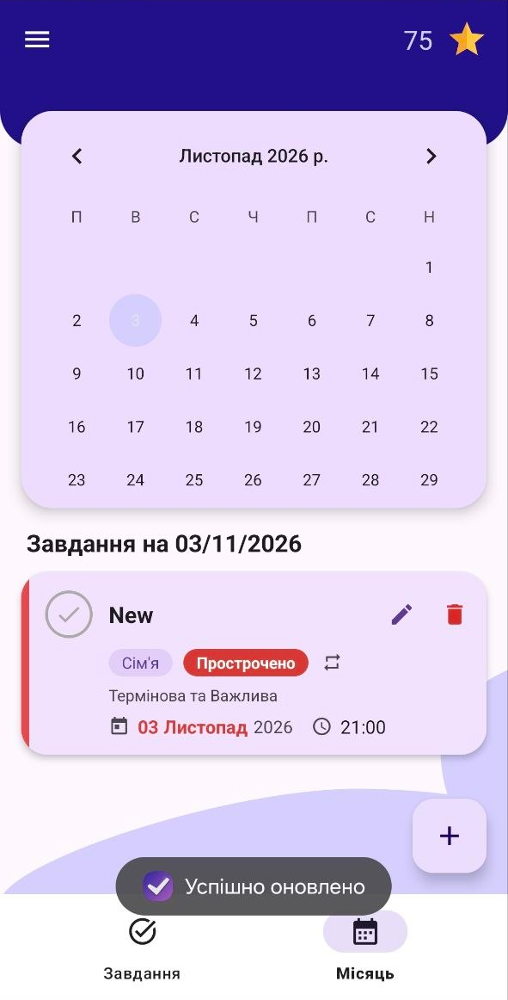<br>
      <sub>Month</sub>
    </td>
  </tr>
</table>

### Statistics

Charts are drawn by the app itself (no chart library):

- level ring with progress to the next reward, day streak (and the best one), completion rate
- bars for tasks finished in the **last 7 days** and planned for the **next 7 days**
- donut chart of open tasks by priority, and bars by category

> History starts with version 1.5.0: earlier versions did not store *when* a task was finished, so the first charts fill in from zero.

<p align="center">
  
  &nbsp;
  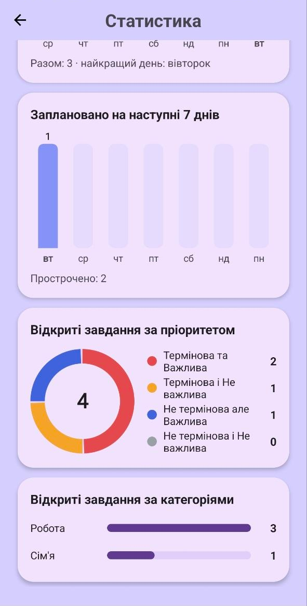
</p>

### Gamification

- 25 points for every task finished on time (late completions earn nothing)
- 12 achievements at point milestones, from 500 to 100,000 points; locked ones are grey
- The profile avatar and the level ring follow your current achievement level

<p align="center">
  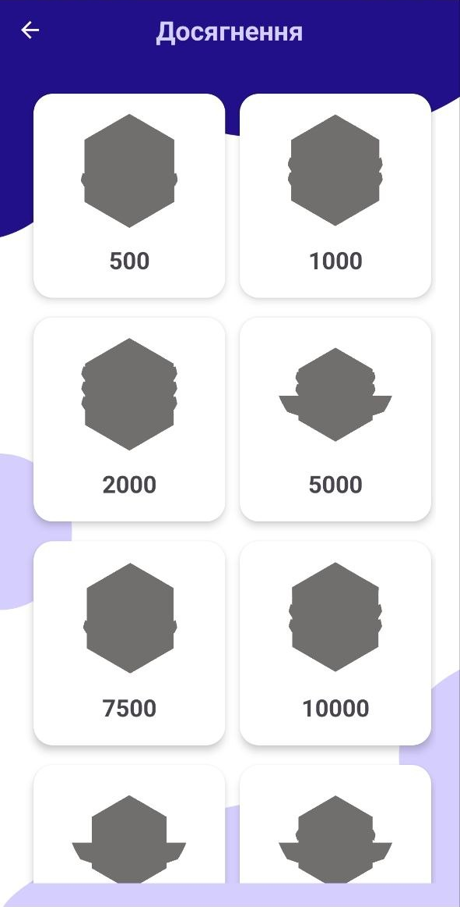
  &nbsp;
  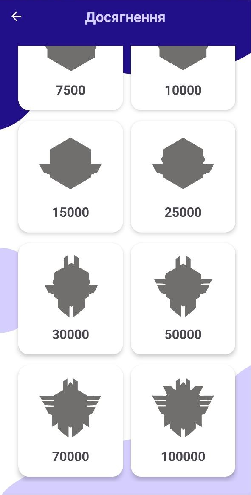
</p>

### Widget and notifications

- **Home-screen widget**: how many tasks are due today and overdue, plus the next four tasks. It reads a local copy of your list and is cleared when you sign out
- **Reminders** 3 days and 1 hour before a deadline (one alarm per task, restored after a reboot or an app update)

### Account

- Email and password registration and sign-in (Firebase Authentication), e-mail provider suggestions, system autofill and "Forgot password?"
- **Continue with Google** (one-time setup: [docs/GOOGLE-SIGNIN.uk.md](docs/GOOGLE-SIGNIN.uk.md))
- Edit your name and password; confirm-with-password before sensitive changes

### Settings

<table>
  <tr>
    <td width="50%" valign="top">
      <ul>
        <li><b>Light / dark theme</b> toggle</li>
        <li>Notifications on / off</li>
        <li>Interface language: Ukrainian, English, French, German. Japanese and Korean translations are included and used when the device language is set to them</li>
        <li><b>Check for updates</b> (menu, Settings and About), see below</li>
      </ul>
    </td>
    <td width="25%" align="center" valign="top">
      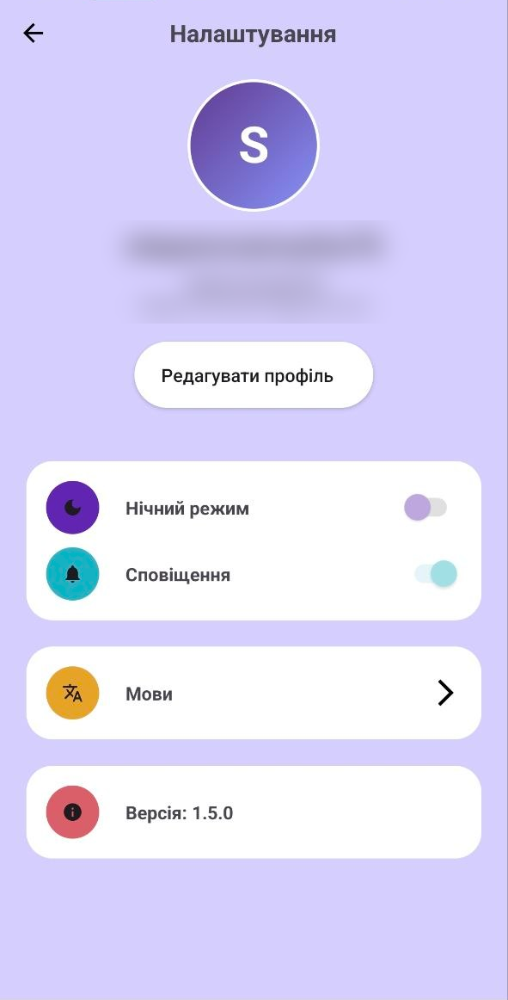<br>
      <sub>Settings</sub>
    </td>
    <td width="25%" align="center" valign="top">
      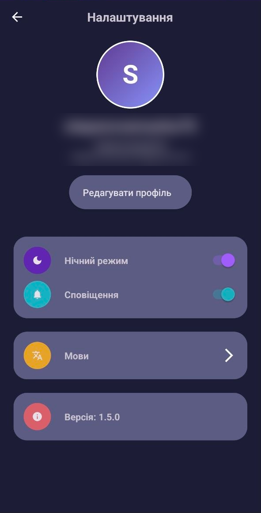<br>
      <sub>Dark theme</sub>
    </td>
  </tr>
</table>

<p align="center">
  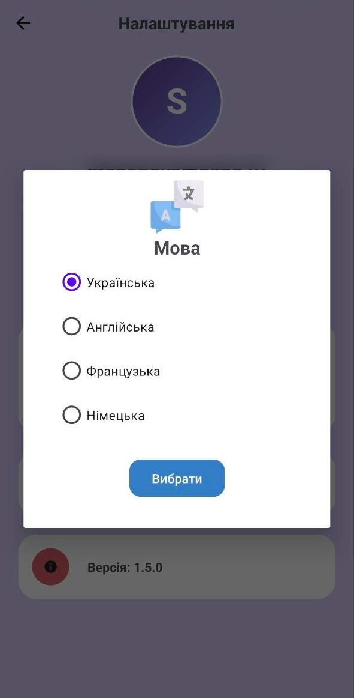
  &nbsp;
  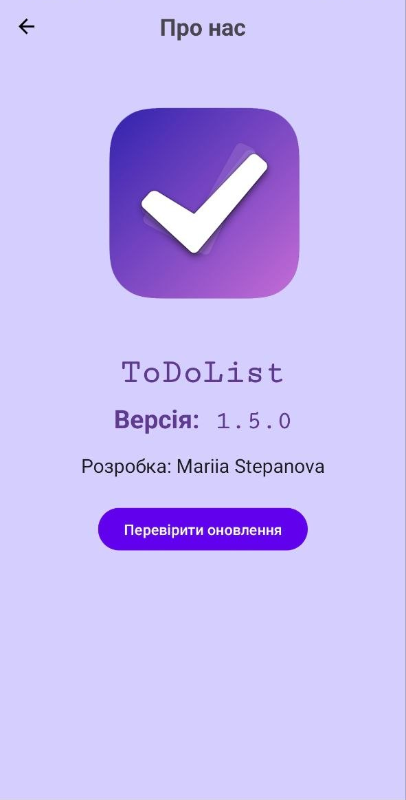
</p>

## Download and updates

Ready-to-install APK files are published on the [Releases](../../releases) page (`ToDoList-vX.Y.Z.apk`, with a `.sha256` file next to it). The app needs **Android 8.1 (API 27) or newer**.

Inside the app, **Menu → Check for updates** looks for a newer release, downloads its APK with a progress bar, verifies the SHA-256 checksum and the signing key, and opens the system installer. After the update the app shows an "updated to X" message with the release notes. The first time, Android asks you to allow installing apps from ToDoList.

Maintainers: see [docs/RELEASING.uk.md](docs/RELEASING.uk.md) (in Ukrainian) for the one-time signing setup and how to publish a version (`git tag v1.2.0 && git push origin v1.2.0`).

## Build from source

Requirements: **Android Studio** (recent stable) and **JDK 17**.

1. Clone the repository
   ```bash
   git clone https://github.com/MNJMARIA/ToDoList.git
   cd ToDoList
   ```
2. Create your own Firebase project and add an Android app with the package name `com.example.todolist`
   - enable **Authentication** (Email/Password, and Google if you want it) and **Realtime Database**
   - download `google-services.json` and place it in the `app/` directory
3. Publish the database security rules from [docs/firebase-rules.json](docs/firebase-rules.json) (each user can access only their own data). Step by step, with a connection check: [docs/FIREBASE-DATABASE.uk.md](docs/FIREBASE-DATABASE.uk.md)
4. Build and run
   ```bash
   ./gradlew assembleDebug        # debug APK
   ./gradlew testDebugUnitTest    # unit tests
   ```
   or press **Run** in Android Studio on a device or an emulator.

Release builds are signed in CI from a `v*` tag; the keystore and its passwords are kept in GitHub secrets and never committed.

## Quality: tests and automatic reports

- The rules that used to be buried in screens (date parsing and deadlines, points and statistics, achievements, repeat series, reminder planning, version comparison, release parsing, checksums, input validation) live in `app/src/main/java/com/example/todolist/core` as plain Java without Android dependencies, and are covered by JUnit tests in `app/src/test`.
- **CI** (`.github/workflows/ci.yml`) runs the tests, Android Lint and a debug build for every push and pull request and writes a summary to the run page.
- **Release** (`release.yml`) builds a signed APK from a `v*` tag, only if the tests pass, and publishes it with a changelog and a test report.
- **Weekly report** (`weekly-report.yml`) posts test and lint results, activity and the latest release as a comment on the issue "Automatic weekly report" every Monday.
- Crash reports go to Firebase Crashlytics ([docs/CRASHLYTICS.uk.md](docs/CRASHLYTICS.uk.md)).

## Technologies

| Category | Technologies |
|----------|--------------|
| **Language** | Java 8 |
| **Platform** | Android, min SDK 27, target SDK 34 |
| **Backend** | Firebase Authentication, Realtime Database (with offline persistence), Crashlytics |
| **UI** | Material Components (Material 3, light and dark), View Binding, RecyclerView, Navigation, custom-drawn charts |
| **Sign-in** | Email and password, Google (Credential Manager) |
| **Testing and CI** | JUnit, Android Lint, GitHub Actions |

## Architecture

A layered, fragment-based app:

- **UI** (`fragments`, `ui`, `utils/adapter`) – screens, custom views (charts, avatar, swipe handling) and adapters
- **Data** (`data`) – `TaskRepository`: the single place that talks to Firebase. It keeps the list live, shows a just-made change at once (before the server confirms it), and updates points, statistics and activity together
- **Core** (`core`) – business rules in pure Java with unit tests, with no Android or Firebase dependency
- **Widget and reminders** (`widget`, `reminders`) – the home-screen widget, alarms and notifications

## Documentation

Most maintainer notes are in Ukrainian.

| Document | What is in it |
|----------|---------------|
| [docs/FIREBASE-DATABASE.uk.md](docs/FIREBASE-DATABASE.uk.md) | Database connection check, region and security rules |
| [docs/firebase-rules.json](docs/firebase-rules.json) | Realtime Database rules to publish |
| [docs/GOOGLE-SIGNIN.uk.md](docs/GOOGLE-SIGNIN.uk.md) | One-time setup of "Continue with Google" |
| [docs/RELEASING.uk.md](docs/RELEASING.uk.md) | Signing and publishing a release |
| [docs/CRASHLYTICS.uk.md](docs/CRASHLYTICS.uk.md) | Crash reporting |
| [docs/FINDINGS.uk.md](docs/FINDINGS.uk.md) | What was found and changed in each version |

## Acknowledgments

- The user interface design and some layout solutions were inspired by publicly available Android development tutorials and educational materials on YouTube (for example Philipp Lackner, Coding in Flow, and similar task planner projects)
- All application logic, data handling and functionality were implemented independently as part of the diploma project
- Special thanks to my supervisor, **Eduard Ruslanovych Smilyi**, for guidance and support throughout the project

## License

This project is licensed under the MIT License – see the [LICENSE](LICENSE) file for details.

---

**Author:** Mariia Stepanova  
**Program:** Software Engineering  
**Institution:** College of Engineering, Management and Land Management, National Aviation University (Kyiv, Ukraine)  
**Year:** 2024
